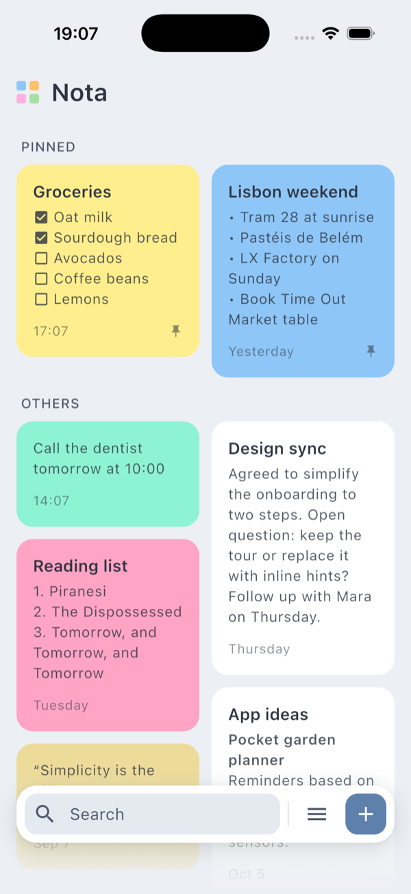
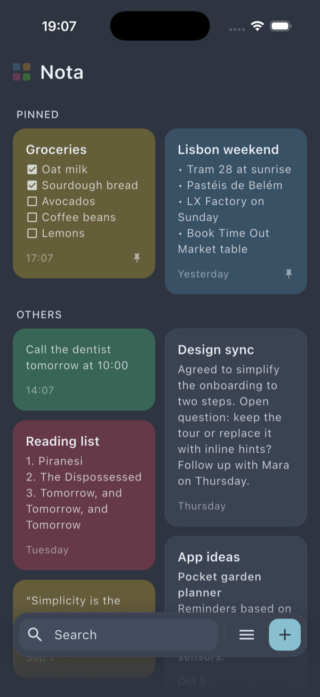
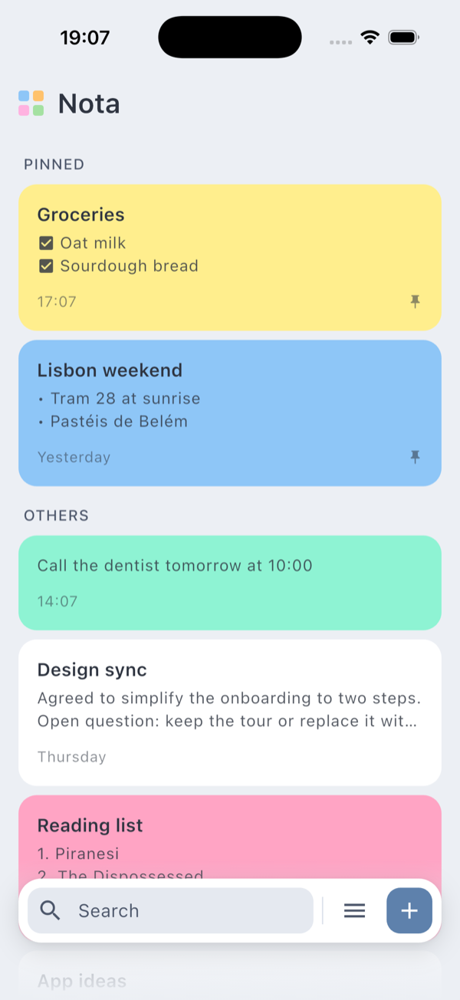
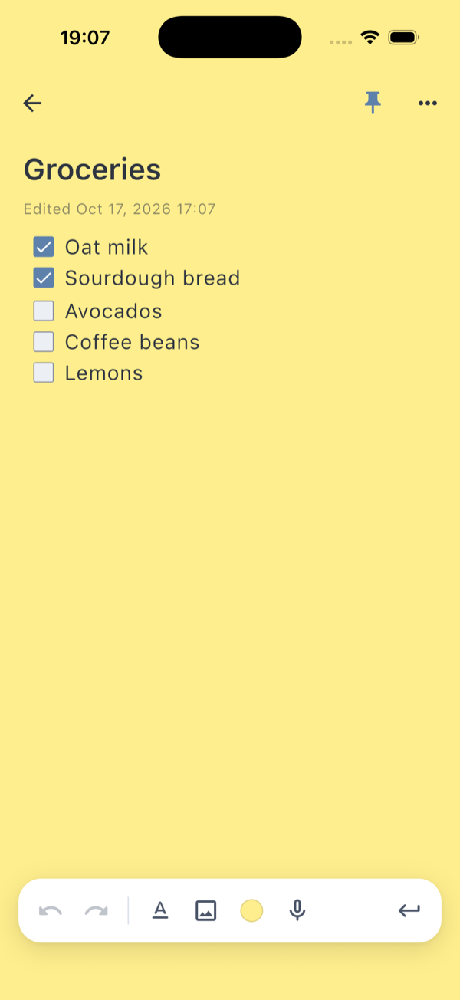
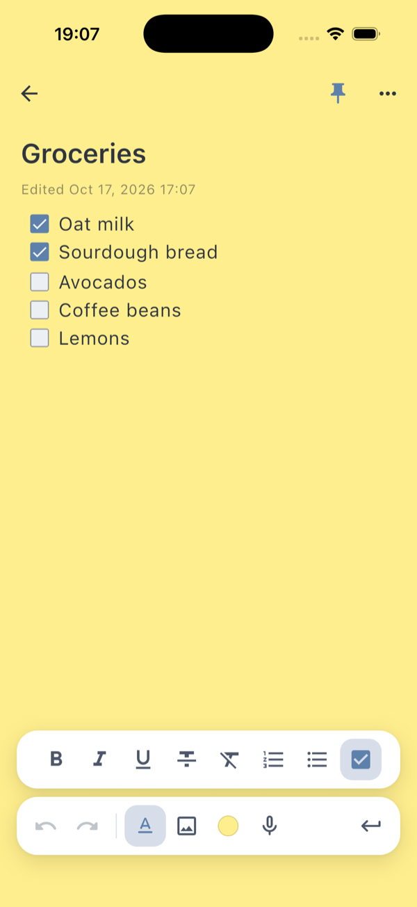
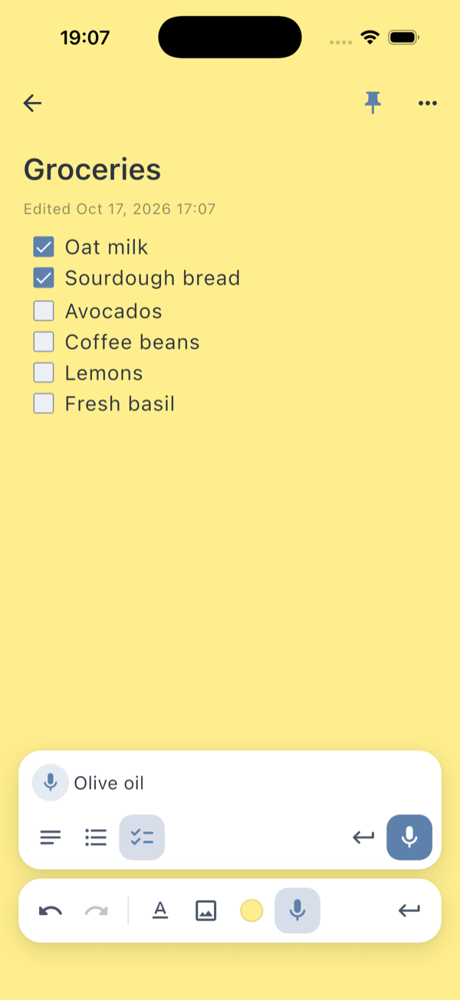
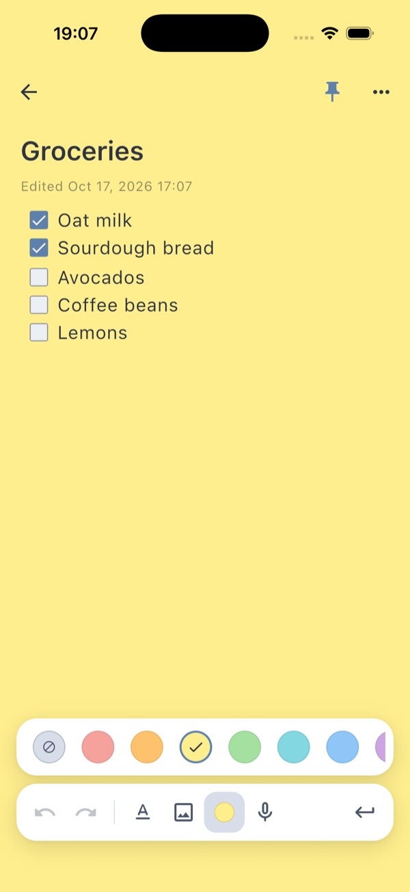
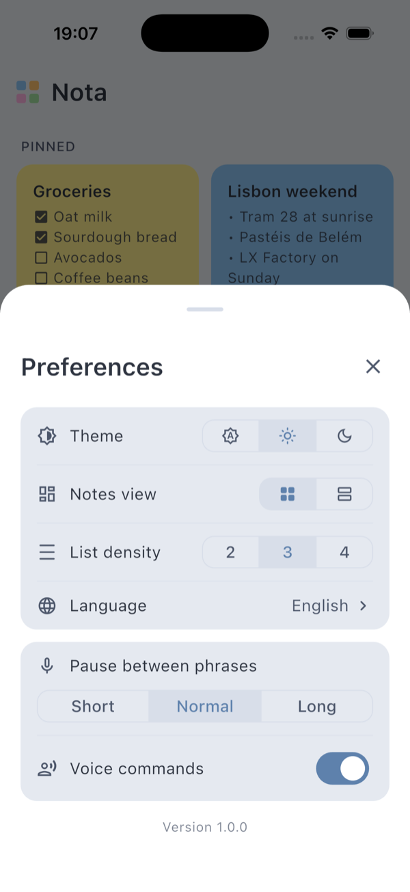
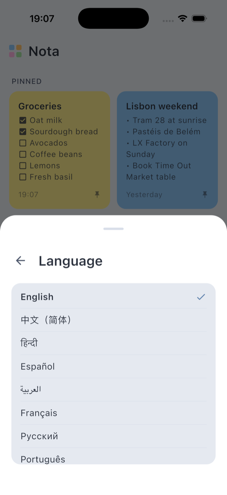

<h1 align="center">
  
  <br/>Nota
</h1>

<p align="center">A minimalist, local-first note-taking app for iOS and Android.</p>

## Screenshots

<table>
  <tr>
    <td align="center"><b>Note list · Light</b></td>
    <td align="center"><b>Note list · Dark</b></td>
    <td align="center"><b>List view</b></td>
  </tr>
  <tr>
    <td></td>
    <td></td>
    <td></td>
  </tr>
  <tr>
    <td align="center"><b>Rich text editor</b></td>
    <td align="center"><b>Formatting</b></td>
    <td align="center"><b>Voice dictation</b></td>
  </tr>
  <tr>
    <td></td>
    <td></td>
    <td></td>
  </tr>
  <tr>
    <td align="center"><b>Color picker</b></td>
    <td align="center"><b>Preferences</b></td>
    <td align="center"><b>10 languages</b></td>
  </tr>
  <tr>
    <td></td>
    <td></td>
    <td></td>
  </tr>
</table>

## Features

**Notes**
- Rich text editor — bold, italic, underline, strikethrough
- Ordered lists, bullet lists, checklists
- Embed images from the gallery
- 16 note colors that tint the whole editor; muted variants in the dark theme
- Pin important notes; pinned notes get their own section
- Search across all notes
- Voice dictation: speak list items one after another and a pause starts the
  next one; say "new line", "undo" or "stop dictation" in any of the ten
  languages instead of touching the screen. Formatting stays available while
  you dictate: toggle bold or switch the line to a checklist and the next
  words follow
- Hands-free entry points: hold the "+" button, or use the "Dictate a note"
  home-screen quick action, to open a new note that is already listening

**Note list**
- Masonry grid or list view, with adjustable list density (2 / 3 / 4 lines)
- Relative timestamps on every card (time, yesterday, weekday, date)
- Swipe to delete, multi-select with batch delete and pin, undo after delete
- Collapsing large-title header, haptic feedback on selection

**Customization**
- Light, dark, and system theme (Nord palette)
- 10 interface languages: English, Russian, Spanish, French, German, Portuguese, Japanese, Chinese, Hindi, Arabic
- Dictation settings: pause length between phrases, voice commands on or off

**Privacy**
- Fully local — no account, no cloud, no analytics
- Works completely offline; dictation uses the system speech recogniser, which
  runs on-device on recent iOS and Android versions

## Tech stack

| Layer | Technology |
|---|---|
| UI | Flutter, flutter_quill |
| State | flutter_bloc (BLoC / Cubit) |
| Navigation | go_router |
| Storage | Drift (SQLite) |
| Architecture | Feature-based monorepo |

## Dependencies

| Package | Purpose |
|---|---|
| [flutter_quill](https://pub.dev/packages/flutter_quill) | Rich text editor |
| [flutter_bloc](https://pub.dev/packages/flutter_bloc) | State management |
| [go_router](https://pub.dev/packages/go_router) | Navigation |
| [drift](https://pub.dev/packages/drift) | SQLite ORM |
| [sqlite3_flutter_libs](https://pub.dev/packages/sqlite3_flutter_libs) | SQLite native binaries |
| [shared_preferences](https://pub.dev/packages/shared_preferences) | Persistent key-value storage |
| [toastification](https://pub.dev/packages/toastification) | In-app toast notifications |
| [flutter_staggered_grid_view](https://pub.dev/packages/flutter_staggered_grid_view) | Masonry note grid |
| [image_picker](https://pub.dev/packages/image_picker) | Pick images from gallery |
| [speech_to_text](https://pub.dev/packages/speech_to_text) | System speech recognition for dictation |
| [wakelock_plus](https://pub.dev/packages/wakelock_plus) | Keep the screen on while dictating |
| [quick_actions](https://pub.dev/packages/quick_actions) | Home-screen shortcut into dictation |
| [smart_keyboard_insets](https://pub.dev/packages/smart_keyboard_insets) | Smooth keyboard inset handling |
| [path_provider](https://pub.dev/packages/path_provider) | App document directory |
| [package_info_plus](https://pub.dev/packages/package_info_plus) | App version info |
| [equatable](https://pub.dev/packages/equatable) | Value equality |
| [bloc_concurrency](https://pub.dev/packages/bloc_concurrency) | Event transformers |
| [uuid](https://pub.dev/packages/uuid) | UUID generation |
| [intl](https://pub.dev/packages/intl) | Localizations and date formatting |

## Project structure

```
lib/                        # App shell, routing, DI
packages/
  shared/                   # Domain models, Delta helpers
  note_repository/          # SQLite persistence (Drift)
  preferences_service/      # User preferences
  component_library/        # Theme, design tokens, shared widgets
  image_files/              # Note image file management
  toast_service/            # Toasts with optional inline action
  speech_service/           # Continuous speech recognition for dictation
  monitoring/               # Logger and error-reporting interfaces
  features/
    note_list/              # Note list screen
    note_details/           # Note editor screen
    preferences_menu/       # Settings bottom sheet
integration_test/           # Screenshot tour (see below)
tool/                       # Dev scripts
```

## Development

Run every package's tests:

```sh
./test_all.sh
```

Regenerate screenshots on a simulator (seeds demo notes, walks through every
screen). Start the watcher first, then the tour:

```sh
tool/screenshot_watcher.sh <simulator-udid> build/screenshots &
flutter test integration_test/screenshot_tour_test.dart -d <simulator-udid>
```

## Requirements

- Flutter 3.41+
- Dart 3.11+
